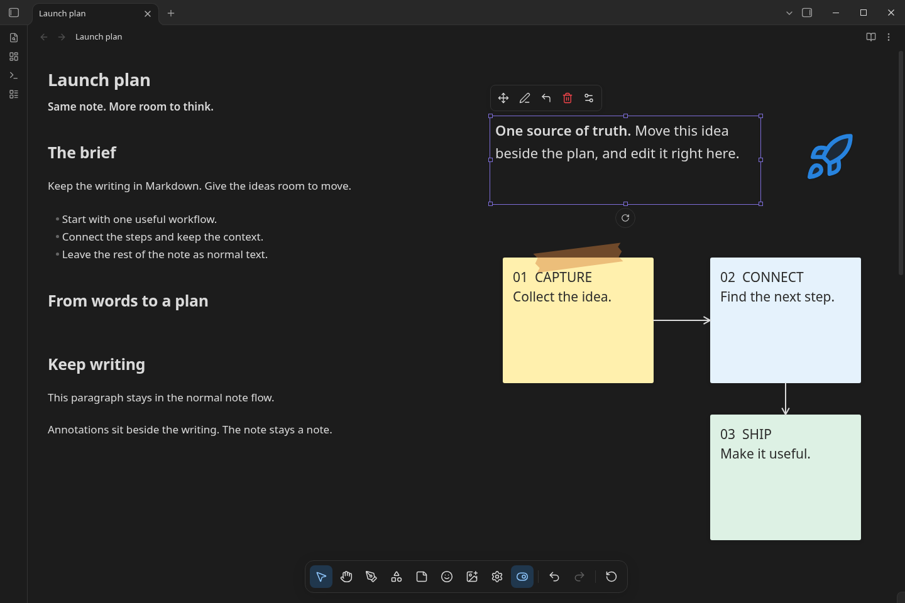
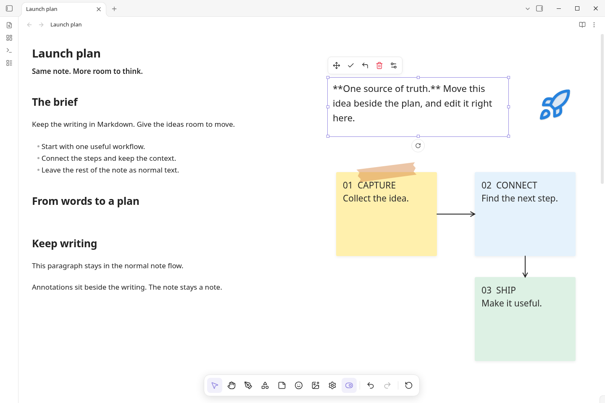
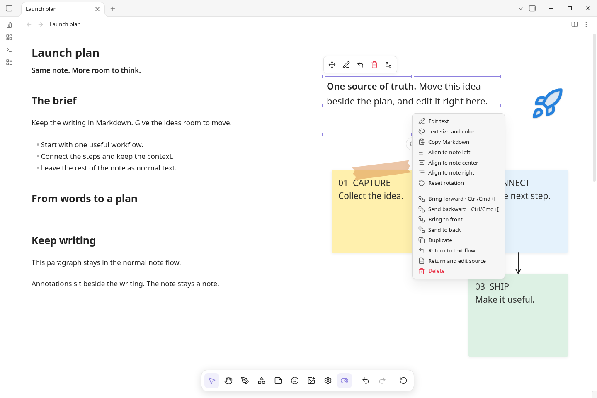
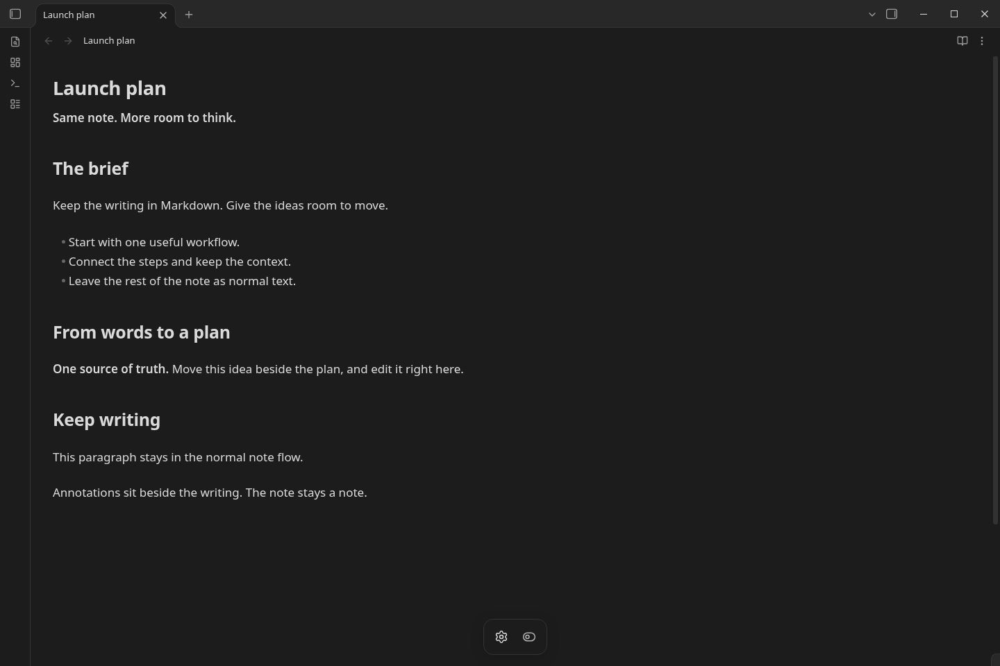

<h1 align="center">Canvsidian</h1>

<p align="center">
  <strong>JAM-inspired spatial tools for your existing Obsidian notes.</strong><br>
  Move an idea. Connect the next step. Keep writing in the same note.
</p>

<p align="center">
  <a href="https://github.com/Ali-Nourix/Canvsidian/releases/latest"></a>
  <a href="https://github.com/Ali-Nourix/Canvsidian/actions/workflows/ci.yml"></a>
  
  
</p>

<p align="center" dir="rtl">
  <strong>همان نوت، همان تب؛ فضای بیشتری برای فکرکردن.</strong><br>
  نوشته را جابه‌جا کن، ایده‌ها را به هم وصل کن و همان‌جا به نوشتن ادامه بده؛ بدون ساخت Canvas یا نوت جداگانه.
</p>



<p align="center">
  <a href="https://github.com/Ali-Nourix/Canvsidian/releases/latest">Download latest release</a> ·
  <a href="#installation">Installation</a> ·
  <a href="#quick-start">Quick start</a> ·
  <a href="docs/SCREENSHOTS.md">Screenshot provenance</a>
</p>

> **این تصاویر از خود اپ Obsidian هستند، نه موکاپ یا harness.** نسخهٔ 1.14.4 روی Linux، افزونهٔ 0.6.5 و تم پیش‌فرض روشن/تیره؛ با یک vault نمونه و بدون اطلاعات شخصی. [جزئیات ثبت تصاویر](docs/SCREENSHOTS.md).
>
> **Experimental:** اجرای نمایشی واقعی، جای آزمون همهٔ تم‌ها، vaultها، نسخه‌ها و افزونه‌های دیگر را نمی‌گیرد. قبل از نصب یا ارتقا از vault و `data.json` بک‌آپ بگیرید.

## چه کاری می‌توانی انجام بدهی؟

| قابلیت | کاربرد |
| --- | --- |
| **بلاک Markdown شناور** | پاراگراف، تیتر، لیست یا بلاک موجود را کنار نوشته‌ها قرار بده؛ متن همچنان در همان فایل `.md` می‌ماند. |
| **ویرایش در همان محل** | Markdown بلاک شناور را همان‌جا ویرایش کن؛ اندازهٔ فونت، رنگ، عرض، ارتفاع و چرخش را تغییر بده. |
| **اتصال ایده‌ها** | دو آبجکت را انتخاب کن تا فلش متصل با مسیر قائم‌زاویه بینشان ساخته شود؛ با حرکت آن‌ها، اتصال به‌روز می‌شود. |
| **یادداشت و ترسیم** | استیکی‌نوت، برچسب، قلم، هایلایتر، شکل، چسب تزئینی، جدول، کد و ۲۹ استیکر محلی اضافه کن. |
| **عکس و آیکون** | تصویر را از سیستم وارد کن یا از کتابخانهٔ آیکون Obsidian انتخاب کن. |
| **فضای چپ و راست** | با `Alt + اسکرول` فقط نمای آبجکت‌ها را جابه‌جا کن؛ متن اصلی نوت همراه آن پن نمی‌شود. |
| **بازگشت به نوت معمولی** | افکت‌ها را پنهان کن؛ متن به جریان معمولی برمی‌گردد، بدون حذف چیدمان ذخیره‌شده. |

## قابلیت‌ها در عمل

### ۱. همان نوشته را همان‌جا ویرایش کن

سمت چپ، بخش عادی نوت است. سمت راست، یک بلاک از همان سند در حالت ویرایش Markdown قرار دارد. دکمهٔ تیک، ویرایش را تمام می‌کند؛ این یک نوت یا ادیتور مستقل جدید نیست.



### ۲. کنترل مرتبط، فقط برای آبجکت انتخاب‌شده

کلیک روی دستگیره، منوی بومی Obsidian را باز می‌کند: ویرایش، تراز، اندازه و ظاهر، ترتیب لایه‌ها، Duplicate و حذف. کنترل چرخش فقط در حالت انتخاب دیده می‌شود. فلش‌های تصویر، اتصال واقعی بین آبجکت‌ها هستند، نه خطوط اضافه‌شده روی اسکرین‌شات.



### ۳. یک دکمه، بازگشت به جریان عادی متن

همان نوت بعد از **Toggle note effects**: متن شناور دوباره در جای اصلی خوانده می‌شود و annotationها پنهان می‌شوند. روشن‌کردن مجدد، چیدمان را برمی‌گرداند. در سناریوی ثبت تصاویر، متن سند پیش و پس از این toggle یکسان بررسی شده است.



<a id="installation"></a>

## نصب و ارتقا

1. از [آخرین Release](https://github.com/Ali-Nourix/Canvsidian/releases/latest)، فایل `Canvsidian-<version>.zip` را بگیر.
2. پوشهٔ داخل ZIP را در `.obsidian/plugins/` مربوط به vault خودت استخراج کن.
3. Obsidian را reload کن و در **Settings → Community plugins**، افزونهٔ **Canvsidian** را فعال کن. برای اجرای افزونهٔ محلی، Restricted mode باید خاموش باشد؛ فقط کدی را فعال کن که به آن اعتماد داری.
4. یک نوت را در حالت **Live Preview** باز کن.

```text
YourVault/.obsidian/plugins/canvesidian/
├── main.js
├── manifest.json
├── styles.css
└── data.json        ← دادهٔ شخصی تو؛ هنگام ارتقا نگه دار
```

**برای ارتقا فقط سه فایل اول را جایگزین کن؛ `data.json` را حذف نکن.** نام نمایشی Canvsidian است، اما شناسه و پوشهٔ نصب عمداً `canvesidian` مانده تا دادهٔ نسخه‌های قبلی حفظ شود. پوشهٔ دوم با نام متفاوت نساز.

حداقل نسخهٔ هدف در manifest برابر **Obsidian 1.8.0** است؛ اجرای نمایشی تصاویر روی **1.14.4** انجام شده است، نه همهٔ نسخه‌های بین این دو.

<a id="quick-start"></a>

## شروع سریع

1. مکان‌نما را داخل بلاک بگذار و از Command palette فرمان **Canvsidian: Float this block in the current note** را اجرا کن. راه دیگر: روی محدودهٔ دستگیره در حاشیهٔ راست هاور کن، کلیک کن و **Float and move** را بزن. هاور روی خود متن دستگیره را نشان نمی‌دهد.
2. بلاک را انتخاب کن و از بدنه یا آیکون جابه‌جایی بکش. با دستگیره‌های قاب، اندازه‌اش را تغییر بده.
3. **Edit text in place** را بزن، Markdown را ویرایش کن و با تیک تمامش کن. از **Text block settings** اندازه و ظاهر متن را تغییر بده.
4. از **Notes and labels** یک استیکی‌نوت و از **Shapes and lines** یک شکل اضافه کن. برای اتصال، **Connect objects** را انتخاب کن؛ اول مبدأ و بعد مقصد را کلیک کن. متن عادی باید ابتدا شناور شود تا مقصد اتصال باشد.
5. نزدیک لبهٔ افقی، فقط نمای آبجکت‌ها هنگام drag حرکت می‌کند. برای پیمایش دستی از `Alt + اسکرول` یا منوی **Object view** استفاده کن.
6. آبجکت خارج از دید؟ انتخابش کن و **Object view → Show selected object** را بزن. **Reset object view** فقط نما را به صفر برمی‌گرداند، نه جای آبجکت‌ها را.

## میان‌برها

| کلید | رفتار |
| --- | --- |
| کلیدهای جهت / `Shift + جهت` | حرکت آبجکت انتخاب‌شده، ۱ / ۱۰ پیکسل |
| `Ctrl/Cmd + ]` / `Ctrl/Cmd + [` | یک لایه جلو / عقب |
| `Ctrl/Cmd + Shift + ]` / `Ctrl/Cmd + Shift + [` | جلوترین / عقب‌ترین لایه |
| `Alt + اسکرول` | پن افقی نمای آبجکت‌ها، نه متن نوت |
| `Escape` | لغو ژست فعال؛ در ویرایش متن، خروج با حفظ تغییرات قابل‌ثبت |

میان‌برهای لایه روی آبجکت انتخاب‌شده عمل می‌کنند، نه هنگام تایپ در textarea یا ادیتور متن. Undo/Redo ترسیم با undo متن سند یکی نیست.

## متن و چیدمان کجا ذخیره می‌شوند؟

- **متن بلاک Markdown** در همان فایل `.md` می‌ماند. ویرایش آن روی همان سند انجام می‌شود؛ حذف واقعی متن، تأیید می‌خواهد.
- **مختصات، نمای افقی، شکل‌ها و annotationها** در `.obsidian/plugins/canvesidian/data.json` ذخیره می‌شوند. این فایل را هم بک‌آپ و sync کن؛ annotationها متن جدید داخل Markdown نیستند.
- **تصویر واردشده** در پوشهٔ attachment تنظیم‌شدهٔ vault کپی می‌شود؛ حذف آبجکت، فایل تصویر را از vault حذف نمی‌کند.
- **Toggle note effects** غیرمخرب است. **Reset entire note layout** پس از تأیید، چیدمان و annotationهای همان نوت را پاک می‌کند، اما Markdown را حذف نمی‌کند.
- تطبیق مبهم یا متن تغییرکرده در بازکردن مجدد، به‌جای پنهان‌کردن یک بخش نامطمئن، جداشده نگه داشته می‌شود. این محافظت جای بک‌آپ را نمی‌گیرد.

## محدودیت‌ها، روشن و ساده

- چیدمان فضایی در **Live Preview** است؛ Reading View و PDF export فعلاً آن را نشان نمی‌دهند.
- ویرایش در محل، textarea حاوی Markdown است؛ Live Preview دوم و تضمین تمام commandها یا autocompleteهای میزبان نیست.
- انتخاب گروهی، گروه‌بندی، زوم اختصاصی، collaboration و export تصویری آماده نیستند. پن افقی آبجکت‌ها وجود دارد؛ canvas واقعاً بی‌نهایت نیست.
- مسیریابی فلش‌ها یک موتور کامل دیاگرام نیست؛ برای آبجکت چرخیده از کادر پیرامونی استفاده می‌کند و در فضای مسدود ممکن است مسیر جایگزین از روی آبجکت‌ها بگذرد.
- مختصات افقی تا `±50,000px` محدود است. هم‌پوشانی آبجکت‌ها آزاد است و چیدمان واکنش‌گرا نیست؛ در چیدمان شلوغ، خط یا آبجکت ممکن است روی کنترل آبجکت دیگری بیفتد.
- همگام‌سازی زندهٔ چند pane/دستگاه یا merge هم‌زمان چیدمان وجود ندارد. ذخیرهٔ debounce می‌تواند آخرین تغییرات پیش از crash را از دست بدهد.
- اجرای نمایشی فعلی روی Linux و تم پیش‌فرض است. سازگاری همهٔ تم‌ها، Live Previewهای پیچیده، embedها، موبایل، IME و افزونه‌های دیگر هنوز نیازمند آزمون بیشتر است.

## توسعه، تست و انتشار

```sh
npm ci
npm run check
npm exec -- playwright install chromium
npm run test:ui
npm run benchmark
```

- **۵۹ تست واحد و ۱۱۹ بررسی مرورگری**؛ تست‌های خودکار از CodeMirror واقعی و API میزبان شبیه‌سازی‌شده استفاده می‌کنند.
- تصاویر این README، جدا از آن harness، در **خود Obsidian 1.14.4** با افزونهٔ تولیدی گرفته شده‌اند. [منبع، سناریو و مشخصات تصاویر](docs/SCREENSHOTS.md).
- benchmark مصنوعی، transactionهای حین drag را اندازه می‌گیرد، **نه FPS یا سرعت همهٔ vaultها**. [روش اندازه‌گیری](docs/PERFORMANCE.md).
- اکشن انتشار، نسخه را از `manifest.json` می‌خواند و پس از تست و بیلد موفق، تگ هم‌نام نسخه و Release می‌سازد؛ نسخهٔ منتشرشده را بازنویسی نمی‌کند. [راهنمای انتشار](docs/RELEASING.md).

## مستندات بیشتر

- [تغییرات 0.6.5](docs/RELEASE-0.6.5.md)
- [منبع و روش ثبت تصاویر واقعی](docs/SCREENSHOTS.md)
- [تاریخچهٔ README و قابلیت‌های قدیمی](docs/README-HISTORY.md) — رفتار فعلی را از همین README بخوان.
- [GPL-3.0](LICENSE)
